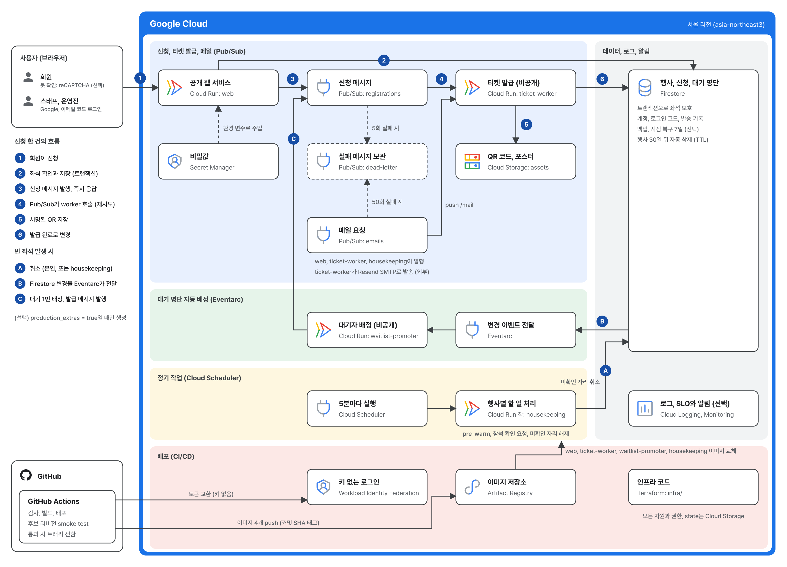

# Cloud Ticketing lab

You build and run an event signup site in your own Google Cloud project. The app code is finished, and you won't write code in this lab. You create the cloud side by hand in the Console, and `./lab` shortcut commands do the repetitive work. After building it, you observe it, break it on purpose, fix it and measure it.

| | |
|---|---|
| Level | Beginner (200) |
| Time | 2-hour session (D0) + 7 to 9 hours over one week |
| Cost | Taken from free trial credit. Budget set to ₩12,000, real cost checked in step 26 |
| Last checked | Not yet (date recorded after a full test run) |

**When you finish, you can**

- Explain, problem by problem, the cloud parts a service with a signup rush needs
- Create and connect Cloud Run services, Pub/Sub, Eventarc, Cloud Scheduler and Firestore in the Console
- Find failures (start failure, 403, 404, retries, dead letter) in the logs and trace each one to the setting that caused it
- Deploy from GitHub Actions without keys, and explain why a broken version doesn't reach users
- Compare cold starts, autoscaling, concurrency and pre-warming with your own measurements

## How to read this sheet

- ☰ is the navigation menu at the top left of the Console. "☰ → **Pub/Sub → Subscriptions**" means: click **Pub/Sub** in ☰, then **Subscriptions** in the left menu. If it isn't in the menu, find it in the full product list at the bottom.
- Bold text is the Console's button and field names. If your Console is in Korean, the Korean sheet (lab.ko.md) has the Korean labels.
- On every screen, first check that the lab project is selected in the project menu at the top.
- What the Console lists under **Jobs** is a Cloud Run job in this sheet.
- Names with underscores, like `PROJECT_ID` and `PROJECT_NUMBER`, stand for your own values. Both are in ☰ → **IAM & Admin → Settings**.

**Step types**

| Mark | Meaning |
|---|---|
| by hand | You create it in the Console. When done, check with `./lab check STEP` |
| shortcut | A `./lab` command creates it. **Do it in the Console**, right below it, shows how to do the same by hand. The command creates only what is missing, so you can build part of it by hand and then run it |
| experiment | Predict, try it, check, and write down the reason |

**Parts of each step:** Problem → Do → Predict → Where to look → Check → Why, If stuck.

**When stuck:** if you're stuck for more than 20 minutes, post the step number, the output of `./lab check STEP` and the error screen in the help thread. To move on without waiting, `./lab skip STEP` builds that step and you go to the next one. Skipped steps are marked in the report.

## Where to look

| Concept (moment in the event) | Steps | Where to look | What you should see |
|---|---|---|---|
| Autoscaling (signups open) | 23, 24 | ☰ → **Cloud Run** → `web` → **Observability** → **Metrics**: container instance count, request latencies | Instances grow when signups rush in, and shrink when it's over |
| Scaling to zero (night) | 22, 26 | The same graph after a long idle period, ☰ → **Billing → Reports** | 0 instances, cost only for the time used |
| State outside the server (creating an event) | 2, 16 | ☰ → **Firestore** → **Firestore Studio**: `events`, `registrations` | The data unchanged after a new revision |
| Transaction (the last seat) | 23 | Firestore Studio → `event_counts` → your event | `held` and `issued` equal the seat count |
| Queue (right after a signup) | 7, 8 | ☰ → **Pub/Sub → Subscriptions** → `ticket-worker` → **Messages**, **Metrics** | Messages waiting while it's Pull, 0 after Push |
| Retries, idempotency, dead letter (a ticket fails) | 9, 10 | `ticket-worker`'s **Logs**, the `dead-letter` subscription's **Messages** | 500s at growing intervals, the message moved to dead letter, `skip` for a duplicate |
| Event-driven (a cancellation) | 11 | ☰ → **Eventarc → Triggers**, `waitlist-promoter`'s **Logs** | A waitlist promotion log a few seconds after the cancellation |
| Scheduled work (the confirmation deadline) | 12 | ☰ → **Cloud Run → Jobs** → `housekeeping` → **History**, ☰ → **Cloud Scheduler** | A run every 5 minutes, released seats |
| Cold start, pre-warming (15 minutes before opening) | 22, 25 | `web`'s instance count graph, `minScale` on the **YAML** tab | A slow first request, 3 instances ready before the opening |
| Who can do what | 3, 5, 8, 20 | ☰ → **IAM & Admin → IAM**, `./lab iam`, each service's **Security** and **Networking** tabs, a secret's **Permissions** tab | For each start failure, 403 and 404, the one setting that caused it |
| Safe changes | 15–19 | GitHub **Actions**, `web`'s **Revisions** tab | A 0% revision, the check, the switch. A failed revision gets 0 traffic |
| Observation | 21, 23 | ☰ → **Logging → Logs Explorer** | The same ticket code in the `web` and `ticket-worker` logs |
| Data retention (30 days later) | 3 | ☰ → **Firestore** → **Time-to-live (TTL)** | 5 policies, Serving |

## Schedule

| Day | Steps | Time |
|---|---|---|
| D0 session | 0–3: project, `./lab start`, Firestore, `./lab base` | 70 min in the session |
| D1 | 4–7: topics and subscriptions, deploying `web`, workers, first signup | 75 min |
| D2 | 8–10: push connection, idempotency, retries and dead letter | 75 min |
| D3 | 11–13: Eventarc, job and Scheduler, pre-warming permission | 60 min |
| D4 | 14–19: GitHub copy, keyless sign-in, deploys, failure and rollback | 100 min |
| D5 | 20–25: access control, logs, cold start, load tests | 110 min |
| D6–7 | 26–27: cost, pausing, submission and review interview | 45 min |



---

# D0. Session

## Step 0. Project and budget (by hand, 10 min)

**Problem.** If you start without knowing what the lab costs, you won't know until the end whether something was left running.

**Do.**
1. ☰ → **IAM & Admin → Manage resources** → **Create project**. Note the **Project ID** under the name.
2. In ☰ → **Billing → My projects**, check that a billing account is linked to the new project. If not, the row's **Actions** menu → **Change billing**.
3. ☰ → **Billing → Budgets & alerts** → **Create budget**. Scope: the lab project. Amount: ₩12,000. Alerts: the defaults.

**Check.** After step 1, `./lab check 0`.

**Why.** A budget only sends alerts. It doesn't stop services. **Don't click "Activate full account".**

## Step 1. Cloud Shell and `./lab start` (shortcut, 15 min)

**Problem.** In a new project almost every service is off, and there are no images to deploy.

**Do.**
1. Click **Activate Cloud Shell** (the >_ icon) at the top right of the Console.
2. Sign in to GitHub. Press Enter and enter the code on the screen at [github.com/login/device](https://github.com/login/device).

   ```bash
   gh auth login --web --scopes workflow
   ```

3. Get the lab repository and start.

   ```bash
   gh repo clone joyrla/gdgoc-tickets-lab
   cd gdgoc-tickets-lab
   ./lab start PROJECT_ID
   ```

What `./lab start` does: installs tools, turns on the APIs, creates the image registry (Artifact Registry) `gdgoc-tickets`, and builds four images in the background (about 5 minutes). Go on to step 2 while the build runs.

<details>
<summary>Do it in the Console</summary>

1. In ☰ → **APIs & Services → Library**, search for each one and click **Enable**: Cloud Run Admin API, Artifact Registry API, Cloud Firestore API, Cloud Pub/Sub API, Secret Manager API, Eventarc API, Cloud Scheduler API, IAM Service Account Credentials API, Security Token Service API, Cloud Billing Budget API.
2. ☰ → **Artifact Registry → Repositories** → **Create repository**. Name `gdgoc-tickets`, format **Docker**, mode **Standard**, location type **Region**, `asia-northeast3 (Seoul)`. **Create**. Check again that the mode is **Standard** before you create it.
3. Then run `./lab start PROJECT_ID`. It leaves what already exists as it is, and only records the settings and builds the images. Images are built only by the command (`./lab images`).
</details>

**Check.** The last line is `Done.` After 5 minutes, `./lab check 1` shows the four images as `ok`.

**If stuck.**

| Message | Fix |
|---|---|
| `cannot see project` | A typo in the project ID. It differs from the project name |
| `no billing account linked` | Step 0, item 2 |
| `image ... is missing` | Still building. `tail ~/.gdgoc-lab/images.log`, and if it stopped, `./lab images` |

Cloud Shell disconnects after a long idle period. When you open it again, start with `cd ~/gdgoc-tickets-lab`.

## Step 2. Firestore database (by hand, 10 min)

**Problem.** Cloud Run adds copies of the server (instances) when there are many requests, and deletes them when there are none. Each copy has its own memory and can disappear at any time, so seat counts and signups must live outside the server.

**Do.** ☰ → **Firestore** → **Create database**.

| Field | Value |
|---|---|
| Database ID | `(default)` |
| Edition | **Standard Edition** |
| Security rules | **Restrictive** |
| Location type | **Region**, `asia-northeast3 (Seoul)` |
| Disaster recovery (PITR, delete protection) | Off |

**The region and edition can't be changed after creation.** If you get them wrong, you have to delete the database and create it again. **Create Database**.

**Predict.** With the security rules set to "Restrictive", will the services be unable to read the data?

**Where to look.** ☰ → **Firestore** → `(default)` → **Firestore Studio**. It is still empty.

**Check.** `./lab check 2`

**Why.** Security rules apply only to browsers and apps that use the Firebase SDKs. The services reach the data with server libraries and IAM permissions, so the rules don't affect them. Transactions in the Standard edition lock the documents they read, so the last seat isn't given to two people.

**If stuck.** If you created it in another region, ☰ → **Firestore** → the database → **Delete**, then create it again. Or `./lab skip 2`.

## Step 3. `./lab base` and `./lab iam` (shortcut, explain, 15 min)

**Problem.** Each service needs an identity (service account), signing keys (secrets), file storage and a deadline for deleting personal data. This part is many clicks and little learning.

**Do.**

```bash
./lab base
./lab iam
```

What `./lab base` creates: TTL (expiry) rules for 5 collections, an index for the waitlist query, the private bucket `PROJECT_ID-assets`, 8 service accounts, 4 secrets, Firestore permissions for the 4 runtime accounts, and bucket permissions.

<details>
<summary>Do it in the Console</summary>

**TTL.** ☰ → **Firestore** → `(default)` → **Time-to-live (TTL)** → **Create policy**. One for each collection group `registrations`, `codes`, `emails`, `login_codes`, `sent_emails`, timestamp field `expire_at`.

**Exclude the expiry field from indexing.** ☰ → **Firestore** → `(default)` → **Indexes** → **Automatic** tab → **Add exemption**. For each of the 5 collections above, field path `expire_at`, query scope **Collection**, and set **Ascending**, **Descending** and **Arrays** all to **Disabled**.

**Waitlist index.** **Indexes** → **Manual** tab → **Create index**. Collection ID `registrations`, fields `event_id` ascending, `status` ascending, `created_at` ascending, query scope **Collection**.

**Bucket.** ☰ → **Cloud Storage → Buckets** → **Create**. Name `PROJECT_ID-assets`, region `asia-northeast3`, public access prevention **On**, access control **Uniform**. After creating it, **Lifecycle** tab → **Add a rule**: delete object, name prefix `tickets/`, age 90 days.

**Service accounts.** ☰ → **IAM & Admin → Service Accounts** → **Create service account**, 8 times. IDs and roles:

| ID | Project role |
|---|---|
| `tickets-web` | Cloud Datastore User |
| `tickets-ticket-worker` | Cloud Datastore User |
| `tickets-waitlist-promoter` | Cloud Datastore User |
| `tickets-housekeeping` | Cloud Datastore User |
| `tickets-pubsub-push` | None |
| `tickets-eventarc` | None |
| `tickets-scheduler` | None |
| `tickets-deployer` | None |

**Secrets.** ☰ → **Security → Secret Manager** → **Create secret**. For `ticket-secret` and `session-secret`, enter a random 32-character value (letters and digits). Create `smtp-password` and `mail-from` without a value (mail is off). Don't grant read access here. That happens in steps 5 and 6.

**Bucket permissions.** Bucket → **Permissions** → **Grant access**. **Storage Object User** for `tickets-web` and `tickets-ticket-worker`.

Once you've created everything, running `./lab base` creates nothing new.
</details>

**Predict.** Why does each service get its own service account?

**Where to look.** The table from `./lab iam`. The same information is spread across ☰ → **IAM & Admin → IAM** and each resource's **Permissions** tab.

**Check.** `./lab check 3`. You're done when you can pick one account in `./lab iam` and say what each of its permissions is for (quiz question 7).

**Why.** If one service is compromised, the damage is limited to that service's permissions. `web` can't read the mail password, and the worker can't change `web`. Where possible, a permission is granted on one resource (one bucket, one secret).

**If stuck.** The `NOT` lines of `./lab check 3` tell you what is missing. You can also run `./lab base` again.

---

# D1. The request path

## Step 4. Topics and subscriptions (by hand, 20 min)

**Problem.** The work right after a signup (making the QR, sending email) is slow and can fail. If the signup reply waits for it, everyone waits during a rush. So `web` only leaves a "registered" message and replies at once.

**Do.**
1. ☰ → **Pub/Sub → Topics** → **Create topic**, 3 times: `registrations`, `emails`, `dead-letter`. Untick **Add a default subscription** each time.
2. ☰ → **Pub/Sub → Subscriptions** → **Create subscription**: the subscription that holds dead letters.

   | Field | Value |
   |---|---|
   | Subscription ID | `dead-letter` |
   | Topic | `projects/PROJECT_ID/topics/dead-letter` |
   | Delivery type | **Pull** |
   | Acknowledgement deadline | 600 seconds |
   | Expiration period | **Never expire** |

3. **Create subscription** once more: the subscription that makes tickets. Create it as **Pull** for now.

   | Field | Value |
   |---|---|
   | Subscription ID | `ticket-worker` |
   | Topic | `projects/PROJECT_ID/topics/registrations` |
   | Delivery type | **Pull** |
   | Acknowledgement deadline | 60 seconds |
   | Expiration period | **Never expire** |
   | Retry policy | **Retry after exponential backoff delay**, minimum 10 seconds, maximum 300 seconds |
   | Dead lettering | On, topic `dead-letter`, maximum delivery attempts **5** |

4. On the **Dead lettering** tab that opens after creation, click **Grant Publisher role** and **Grant Subscriber role**.

**Predict.** While the subscription doesn't send messages anywhere yet, are the messages that arrive lost?

**Where to look.** Subscription `ticket-worker` → **Details** and **Dead lettering** tabs.

**Check.** `./lab check 4`

**Why.** A topic is the name messages are sent to, and a subscription delivers them to one receiver. A subscription keeps each message for the retention period (7 days by default) and deletes it only after the receiver pulls it or accepts it. A message that fails 5 times moves to `dead-letter`, where a person looks at it. The two roles in item 4 let Pub/Sub itself move failed messages.

**If stuck.** If you created a topic without unticking the default subscription, delete that subscription (`registrations-sub` and so on). If the warning on the dead-letter tab stays, click the buttons again. Or `./lab skip 4`.

## Step 5. Deploy `web` (by hand, deliberate failure, 25 min)

**Problem.** You need a public service that takes signups. This service signs tickets and sign-in cookies, so it has to read the signing keys.

**Do.**
1. In Cloud Shell, print the values to paste.

   ```bash
   ./lab env web
   ```

2. ☰ → **Cloud Run → Services** → **Deploy container** → **Service**.

   | Field | Value |
   |---|---|
   | Container image URL | The `image:` line of `./lab env web` |
   | Service name | `web` |
   | Region | `asia-northeast3 (Seoul)` |
   | Authentication | **Allow public access** |
   | Billing | **Request-based** |
   | Service scaling | Auto scaling, minimum 0, maximum 20 |
   | Ingress | **All** |

3. Expand **Containers, Networking, Security**.

   | Where | Value |
   |---|---|
   | Container → **Settings** | Memory 512 MiB, CPU 1, **Startup CPU boost** on |
   | Container → **Settings → Add health check** | **Startup check**, HTTP, path `/health`, port 8080, period 2 seconds, failure threshold 30 |
   | Container → **Requests** | Request timeout 300 seconds, maximum concurrent requests per instance 40 |
   | Container → **Variables & Secrets** → **Add variable** | Paste the whole variable block of `./lab env web` into the first **Name** box |
   | Container → **Variables & Secrets** → **Reference a secret** | `TICKET_SECRET` → `ticket-secret` version 1, `SESSION_SECRET` → `session-secret` version 1 |
   | **Security** tab | Service account `tickets-web` |

4. If a permission warning or a **Grant** button appears next to a secret, **don't click it.**
5. **Create**.

In this form, Enter submits at once. Move between fields by clicking.

**Predict.** Will `web` start?

**Where to look.** The error message on the `web` service page, and the red mark on the **Revisions** tab.

**Check.** It fails to start. The message shows `Permission denied on secret` and `tickets-web`.

Now fix it.
1. ☰ → **Security → Secret Manager** → `ticket-secret` → **Permissions** tab → **Grant access**.
2. New principal `tickets-web@PROJECT_ID.iam.gserviceaccount.com`, role **Secret Manager Secret Accessor**. **Save**.
3. Give `session-secret` the same permission.
4. ☰ → **Cloud Run** → `web` → **Edit & deploy new revision** → **Deploy**.

This time a green check appears, and the service URL shows the home page. `./lab check 5`.

**Why.** A service runs as its own service account, and it can't use permissions that account doesn't have. You granted the permission on one secret, not on the whole project. So `web` can't read the mail password (`smtp-password`).

> **S1:** the failed revision's message, then the working service

**If stuck.** `runs as ... not tickets-web`: the service account on the **Security** tab. If the variables merged into one line, fix them one by one under **Variables & Secrets**. Or `./lab skip 5`.

## Step 6. `./lab workers` (shortcut, compare, 10 min)

**Problem.** You need `ticket-worker`, which makes tickets, and `waitlist-promoter`, which gives freed seats to the waitlist. Neither will ever be called from the internet.

**Do.**

```bash
./lab workers
```

What it creates: the two workers, the `mailer` subscription (the path sign-in code emails take), topic and secret permissions, permission for `tickets-pubsub-push` to call `ticket-worker`, and event-receiving permission for `tickets-eventarc`.

<details>
<summary>Do it in the Console</summary>

**Two services.** Create them with the same form as in step 5, entering only the values that differ. The variables are the block from `./lab env web` without the two lines `DEAD_LETTER_SUBSCRIPTION` and `SIGNUPS_PER_MINUTE_PER_IP`.

| Field | `ticket-worker` | `waitlist-promoter` |
|---|---|---|
| Image | `.../ticket-worker:lab` | `.../waitlist-promoter:lab` |
| Authentication | **Require authentication** | **Require authentication** |
| Ingress | **Internal** | **Internal** |
| Maximum instances | 5 | 3 |
| Request timeout | 60 seconds | 60 seconds |
| Maximum concurrent requests per instance | 2 | 2 |
| Secrets | `TICKET_SECRET` → `ticket-secret` 1 | None |
| Service account | `tickets-ticket-worker` | `tickets-waitlist-promoter` |

**`mailer` subscription.** ☰ → **Pub/Sub → Subscriptions** → **Create subscription**. ID `mailer`, topic `emails`, **Push**, endpoint `https://ticket-worker-PROJECT_NUMBER.asia-northeast3.run.app/mail`, **Enable authentication**, service account `tickets-pubsub-push`, audience `https://ticket-worker-PROJECT_NUMBER.asia-northeast3.run.app`, acknowledgement deadline 60 seconds, never expire, exponential backoff 10 to 300 seconds, dead letter `dead-letter` after 50 attempts. After creating it, **Grant Subscriber role** on the **Dead lettering** tab.

**Permissions.**

| Resource | Principal | Role |
|---|---|---|
| Service `ticket-worker` (tick it in Cloud Run → Services → **Permissions**) | `tickets-pubsub-push` | Cloud Run Invoker |
| Secrets `ticket-secret`, `smtp-password`, `mail-from` | `tickets-ticket-worker` | Secret Manager Secret Accessor |
| Topic `registrations` (tick the topic → **Permissions**) | `tickets-web`, `tickets-waitlist-promoter`, `tickets-housekeeping` | Pub/Sub Publisher |
| Topic `emails` | `tickets-web`, `tickets-ticket-worker`, `tickets-housekeeping` | Pub/Sub Publisher |
| Subscription `dead-letter` | `tickets-web` | Pub/Sub Subscriber |
| Project (☰ → **IAM & Admin → IAM** → **Grant access**) | `tickets-eventarc` | Eventarc Event Receiver |
</details>

**Predict.** How do the two workers' ingress and concurrency differ from `web`'s? Why?

**Where to look.** ☰ → **Cloud Run** → each service's **Networking** tab (ingress), **Scaling** tab and **Containers** tab (concurrency, maximum instances).

**Check.** `./lab check 6`. `web` has ingress **All** and concurrency 40. The workers have **Internal** and concurrency 2.

**Why.** The workers are called only from inside Google Cloud (Pub/Sub, Eventarc), so their door to the internet is closed. Concurrency 2 × at most 5 instances = up to 10 tickets at once. This limits the rate, so the mail service and Firestore aren't hit all at once.

**If stuck.** `Step 4 first`: the three topics must exist. `images are not in the registry yet`: wait for the build from step 1 to finish.

## Step 7. First signup (experiment, 20 min)

**Problem.** The signup got a reply but there's no ticket yet. Where is the work in between?

**Do.**
1. Open `web`'s URL with `/login` added at the end. The email is the Google account you signed in to Cloud Shell with. **코드 받기** (get code).
2. ☰ → **Logging → Logs Explorer**. Enter `"sign-in code for organizer"` in the query and click **Run query**. Enter the 6 digits at the end of the top line. The first time takes about 20 seconds. (`./lab code` shows the same line.)
3. `/admin` → **새 행사 만들기** (new event). All times are Korea time.

   | Field | Value |
   |---|---|
   | 행사 이름, 장소 (name, venue) | Anything |
   | 주소 (address) | `wiring` |
   | 신청 시작 (signups open) | 2 hours ago |
   | 신청 마감 (signups close) | Tomorrow |
   | 시작, 종료 (start, end) | The day after tomorrow |
   | 참석 확인 마감 (confirmation deadline) | Between tomorrow and the day after |
   | 정원, 대기 정원 (seats, waitlist) | 200, 50 |
   | 공개 (published) | Ticked |

   Later events list only the values that differ. **If 공개 (published) isn't ticked, the signup page won't open.**

4. Sign up at `/events/wiring`.

**Predict.** What will the ticket page show?

**Where to look.** ☰ → **Pub/Sub → Subscriptions** → `ticket-worker` → **Messages** tab → **Pull**. Pull with **Enable ack messages** unticked.

**Check.** The ticket stays at **티켓 발급 중** (issuing ticket). One `{"registration_id": ...}` message is waiting in the subscription.

**Why.** `web` saved the seat in Firestore, left a message, and replied at once. A pull subscription only holds the message until someone pulls it. The message isn't lost.

> **S2:** the waiting message and the ticket page showing 티켓 발급 중

**If stuck.** If no code appears, run the query again after 30 seconds. `mail_off` error: the email you entered at `/login` differs from `ADMIN_EMAILS` (`./lab env web`).

---

# D2. Background work and failures

## Step 8. Pull → push (by hand, deliberate failure, 20 min)

**Problem.** If messages only wait, tickets never come out. The subscription has to send messages to `ticket-worker`.

**Do.**
1. ☰ → **Cloud Run** → copy `ticket-worker`'s **URL**.
2. ☰ → **Pub/Sub → Subscriptions** → `ticket-worker` → **Edit**.
3. **Delivery type**: **Push**. **Endpoint URL**: the URL you copied.
4. Leave **Enable authentication** **unticked** and click **Update**.

**Predict.** Will the ticket come out now?

**Where to look.** ☰ → **Cloud Run** → `ticket-worker` → **Observability → Logs**.

**Check.** `403` and `The request was not authenticated` repeat. Once you see it 2 or 3 times, fix it right away (after 5 failures the message moves to `dead-letter`).
1. Subscription → **Edit** → tick **Enable authentication** → service account `tickets-pubsub-push` → **Update**.
2. Within 1 to 2 minutes, the ticket from step 7 is issued. Don't sign up again.

`./lab check 8`

**Why.** `ticket-worker`'s ingress is **Internal**, so requests from Pub/Sub can get in. But it is set to **Require authentication**, so an unsigned request gets a 403. With authentication on, Pub/Sub signs as `tickets-pubsub-push`, and this account is `ticket-worker`'s **Cloud Run Invoker** (`./lab iam`). Getting through the door (ingress) and having the right to enter (IAM) are separate.

> **S3:** the 403 logs and the issued ticket

**If stuck.** If the ticket still shows 티켓 발급 중 after the fix, the message has already gone to `dead-letter`. Sign up once more. Or `./lab skip 8`.

## Step 9. Send the same message again (idempotency) (experiment, 10 min)

**Problem.** Pub/Sub delivers messages "at least once". The same message can arrive twice.

**Do.** The ticket ID is the last part of the ticket address, `/t/TICKET_ID`.
1. ☰ → **Pub/Sub → Topics** → `registrations` → **Messages** tab → **Publish message**.
2. Body: `{"registration_id":"TICKET_ID"}` → **Publish**.

**Predict.** Will one more ticket appear?

**Where to look.** `ticket-worker` → **Logs**, about 30 seconds later.

**Check.** `skip TICKET_ID (status issued)`. There is still one ticket.

**Why.** The receiver first checks whether the ticket was already issued. Getting the same result however many times the same work runs is idempotency (`issue` in `ticket_worker/main.py`).

> **S4:** the `skip` log

## Step 10. Worker failure, retries, dead letter (experiment, 25 min)

**Problem.** If the worker breaks, what happens to the people signing up?

**Do.**
1. ☰ → **Cloud Run** → `ticket-worker` → **Edit & deploy new revision** → **Variables & Secrets** → **Add variable**: `WORKER_FAIL_RATE` = `1` → **Deploy**.
2. On the **Revisions** tab, check that the new revision has 100%.
3. In a browser **incognito window**, open `/events/wiring` and sign up with another email.

**Predict.** Will the signup succeed? What happens to the ticket?

**Where to look.**
- `ticket-worker` → **Logs**: the gaps between 500 responses
- ☰ → **Pub/Sub → Subscriptions** → `ticket-worker` → **Dead lettering** tab: the settings from step 4
- About 3 minutes later, subscription `dead-letter` → **Messages** → **Pull** (ack unticked)

**Check.** The signup succeeds. The 500s repeat at growing intervals, then stop, and the message is in `dead-letter`.

Now fix it.
1. On the same screen, delete `WORKER_FAIL_RATE` and click **Deploy**. Check that the new revision has 100%.
2. Send the failed message again.

   ```bash
   scripts/replay-dead-letters.sh --replay
   ```

3. The ticket is issued within seconds.

**Why.** Signup and issuing are split by a message, so signups still come in while the worker is broken. Retries fix temporary failures, and the growing gaps keep a broken service from being flooded. A bug isn't fixed by retrying, so after 5 attempts a person looks at it.

> **S5:** the repeating 500 logs, the message waiting in `dead-letter`

**If stuck.** If there are 2 or more messages, the job that runs every 5 minutes sent the stuck ticket again (from step 12 on). That's normal.

---

# D3. Events and scheduled work

## Step 11. Eventarc trigger (by hand, experiment, 20 min)

**Problem.** When someone cancels, the seat has to go to the first person on the waitlist. Cancellations happen in several places (the person, an admin, the deadline). Instead of adding code in each place, react to the data change itself.

**Do.**
1. In ☰ → **Cloud Run → Services**, tick `waitlist-promoter` → **Permissions** → **Add principal**: `tickets-eventarc@PROJECT_ID.iam.gserviceaccount.com`, role **Cloud Run Invoker** → **Save**.
2. ☰ → **Eventarc → Triggers** → **Create trigger**.

   | Field | Value |
   |---|---|
   | Trigger name | `registration-changed` |
   | Trigger type | Google sources |
   | Event provider | **Cloud Firestore** |
   | Event type | `google.cloud.firestore.document.v1.updated` (not the `withAuthContext` one) |
   | Region | `asia-northeast3` (filled in automatically) |
   | Filter 1 | `database` = `(default)` (filled in automatically) |
   | Filter 2 (**Add filter**) | `document`, operator **Path pattern**, value `registrations/{registration}` |
   | Service account | `tickets-eventarc` |
   | Event destination | Cloud Run, service `waitlist-promoter`, path `/` |

3. **Create**. It takes about a minute. Ignore the notice asking you to grant a Pub/Sub role.

Then the experiment. New event `promo`: seats 1, waitlist 1.
1. In the signed-in window, sign up at `/events/promo`.
2. In the incognito window, sign up with another email. You become **대기 1번** (waitlist 1).
3. On the first ticket page, click **신청 취소** (cancel signup).

**Predict.** Who gives the seat to the waiting person, and based on what?

**Where to look.** The ticket page in the incognito window, `waitlist-promoter` → **Logs**, and the `status` of the two documents in `registrations` in Firestore Studio.

**Check.** Within a few seconds, the waiting person gets a ticket. `./lab check 11`.

**Why.** When a cancellation changes a Firestore document, Eventarc delivers the change to `waitlist-promoter`. `web` takes no part in the waitlist. The path pattern filter keeps changes to documents outside `registrations` from arriving.

> **S6:** the trigger screen and the ticket issued to the waiting person

**If stuck.** If no seat is given, look for a 403 in `waitlist-promoter`'s logs. The permission from item 1 is missing. Or `./lab skip 11`.

## Step 12. Job and Cloud Scheduler (by hand, experiment, 30 min)

**Problem.** Some work has to happen without anyone clicking: the confirmation deadline, reminders, preparing before the opening.

**Do.**
1. Print the values with `./lab env job`.
2. ☰ → **Cloud Run → Jobs** → **Deploy container**.

   | Field | Value |
   |---|---|
   | Container image URL | The `image:` line of `./lab env job` |
   | Job name | `housekeeping` |
   | Region | `asia-northeast3` |
   | Number of tasks | 1 |
   | Container → **Task capacity** | Task timeout 4 minutes, number of retries per failed task 0 |
   | Container → **Variables & Secrets** | Paste the block from `./lab env job` into the first Name box |
   | **Security** tab | Service account `tickets-housekeeping` |
   | Execute job immediately | Unticked |

   **Create**.
3. In ☰ → **Cloud Run → Jobs**, tick `housekeeping` → **Permissions** → **Add principal**: `tickets-scheduler@PROJECT_ID.iam.gserviceaccount.com`, role **Cloud Run Invoker** → **Save**. On a job, this role means "may run it".
4. `housekeeping` → **Triggers** tab → **Add scheduler trigger**.
   - Name `housekeeping` (delete the suggested name)
   - Region `asia-northeast3`
   - Frequency `*/5 * * * *`
   - Timezone: search for `South Korea` → **Korean Standard Time (KST)**. `Seoul` and `Korea` find nothing.
   - **Continue** → service account `tickets-scheduler` → **Create**.
5. ☰ → **Cloud Scheduler** → the `housekeeping` row's menu → **Force run**.

**Predict.** Will the job succeed?

**Where to look.** ☰ → **Cloud Run → Jobs** → `housekeeping` → **History** tab → open the execution and its **Logs**.

**Check.** The execution shows as **Failed**, and the logs have `pre-warm failed` and a 403. The job has no permission to read `web`'s settings. You fix this in step 13. The rest of the work (deadline, repair) ran as usual. `./lab check 12`.

**Watch the deadline release.** New event `deadline`: seats 1, waitlist 1.
1. Sign up in the signed-in window. **Don't click 참석 확인 (confirm attendance).**
2. In the incognito window, sign up with another email. 대기 1번 (waitlist 1).
3. `housekeeping` → the arrow next to **Execute** at the top → **Execute with overrides** → container arguments `--force-release` → **Execute**.

**Check.** The first seat is released, and a few seconds later the waiting person gets a ticket. Unconfirmed seats of other events are released too (fine for lab data).

**Why.** A job ends when its work is done. It doesn't wait for requests, so it is a job and not a service. The real deadline release returns a seat only after the confirmation reminder email has gone out. In the lab, email is off, so `--force-release` ran just the deadline release at once. Eventarc delivered the Firestore document the job changed, and the seat went to the waiting person. Scheduled work and an event worked one after the other.

> **S7:** the job's execution history, the ticket of the waiting person who got the released seat

**If stuck.** If the Scheduler run shows `PERMISSION_DENIED`, check the permission in item 3. If you can't find the timezone, search for `South Korea`. Or `./lab skip 12`.

## Step 13. `./lab warmup` (shortcut, explain, 10 min)

**Problem.** Right before signups open, the job has to raise `web`'s minimum instances so the first people don't wait (step 25). The 403 in step 12 came from this missing permission.

**Do.**

```bash
./lab warmup
```

What it creates: the custom role `webScaler` (read and update the service, those two permissions only), that role on the `web` service alone, and permission to act as `tickets-web` (act-as).

<details>
<summary>Do it in the Console</summary>

1. ☰ → **IAM & Admin → Roles** → **Create role**. Title `Change web's scaling`, ID `webScaler`, and add only two permissions: `run.services.get`, `run.services.update`. **Create**.
2. In ☰ → **Cloud Run → Services**, tick `web` → **Permissions** → **Add principal**: `tickets-housekeeping`, role **Change web's scaling** → **Save**.
3. ☰ → **IAM & Admin → Service Accounts** → `tickets-web` → **Principals with access** → **Grant access**: `tickets-housekeeping`, role **Service Account User** → **Save**.
</details>

**Predict.** Will a forced run succeed now?

**Where to look.** **Force run** in Cloud Scheduler → the job's **History**.

**Check.** The execution succeeds. `./lab check 13`.

**Why.** Cloud Run has no permission for "change only the minimum instances", so you made a role with just the two permissions needed. But on every change to a service, Cloud Run also asks for permission to act as that service's account (act-as). act-as also allows deploying new code as that account, so it is a deliberate exception to least privilege. That's why the scope is narrowed to this one job and this one account.

---

# D4. Safe changes

## Step 14. Your GitHub copy (by hand, 10 min)

**Problem.** To test and deploy automatically when the code changes, you need a repository you can push to.

**Do.**
1. [github.com/joyrla/gdgoc-tickets-lab](https://github.com/joyrla/gdgoc-tickets-lab) → **Use this template** → **Create a new repository**.
2. Owner: your personal account (not an organization). Name `gdgoc-tickets`. **Private**. **Create repository**.
3. Check that the new repository's **Actions** tab opens.
4. In Cloud Shell, move to the copy. From now on, work in this folder.

   ```bash
   cd ~
   gh repo clone YOUR_GITHUB_USERNAME/gdgoc-tickets
   cd gdgoc-tickets
   ./lab check 14
   ```

**Predict.** Why make it from the template and not as a fork?

**Check.** `./lab check 14` shows `ok`.

**Why.** A fork starts with Actions turned off and stays tied to the original repository. A template copy is an independent repository. The lab settings (`~/.gdgoc-lab`) are kept apart from the folder, so `./lab` works the same in the new folder.

**If stuck.** `./lab skip 14` creates the copy and clones it to `~/gdgoc-tickets`.

## Step 15. Keyless sign-in (by hand, shortcut, 35 min)

**Problem.** To deploy, GitHub Actions has to sign in to Google Cloud. If a key file is kept in GitHub and leaks, anyone can deploy with it.

**Do.**
1. Print the values. The repository ID (a number) is here.

   ```bash
   ./lab env github
   ```

2. ☰ → **IAM & Admin → Workload Identity Federation** → create a pool.
   - Name `github` → **Continue**
   - Select a provider **OpenID Connect (OIDC)**, provider name `gdgoc-tickets`, issuer URL `https://token.actions.githubusercontent.com`, audiences **Default audience** → **Continue**
   - Provider attributes (Google on the left, OIDC on the right), 4 rows:

     | Google | OIDC |
     |---|---|
     | `google.subject` | `assertion.sub` |
     | `attribute.repository` | `assertion.repository` |
     | `attribute.repository_id` | `assertion.repository_id` |
     | `attribute.ref` | `assertion.ref` |

   - **Add condition**: the `attribute condition` line of `./lab env github` → **Save**
3. Pool `github` → **Grant access** → **Grant access using Service Account impersonation** → service account `tickets-deployer` → **Only identities matching the filter**: attribute name `repository_id`, value the repository ID → **Save** → **Dismiss** the dialog.
4. Give the deploy account its permissions.

   ```bash
   ./lab deployer
   ```

   <details>
   <summary>Do it in the Console</summary>

   - In ☰ → **Artifact Registry → Repositories**, tick `gdgoc-tickets` → **Permissions** → **Add principal**: `tickets-deployer`, **Artifact Registry Writer**.
   - ☰ → **IAM & Admin → IAM** → **Grant access**: `tickets-deployer`, **Cloud Run Developer**.
   - In ☰ → **IAM & Admin → Service Accounts**, for each of `tickets-web`, `tickets-ticket-worker`, `tickets-waitlist-promoter`, `tickets-housekeeping` → **Principals with access** → **Grant access**: `tickets-deployer`, **Service Account User**.
   </details>

5. Your GitHub copy → **Settings → Secrets and variables → Actions** → **Variables** tab → **New repository variable**, 3 times: `GCP_PROJECT_ID`, `WIF_PROVIDER`, `DEPLOYER_SA` from `./lab env github`.
6. **Actions** tab → **Sign-in test** on the left → **Run workflow** → Branch `main` → **Run workflow**.

**Predict.** If someone else runs the same workflow in their own repository, can they sign in to your project?

**Where to look.** The run's **Signed in as the deployer** step, and ☰ → **IAM & Admin → Workload Identity Federation** → `github` → the provider's condition.

**Check.** A green check, and `tickets-deployer@...` is printed. `./lab check 15`.

**Why.** GitHub gives each run a short-lived token. It contains the repository ID and the branch. Google Cloud accepts only tokens that match the condition (your repository ID, `main`) and exchanges them for `tickets-deployer`'s access. A repository name can be deleted and created again, but an ID can't, so the ID is used. No key is stored anywhere.

> **S8:** the successful Sign-in test run

**If stuck.**

| Error | Cause |
|---|---|
| `unauthorized_client`, `rejected by the attribute condition` | The repository ID in the condition, or a run from a branch other than `main` |
| `Permission 'iam.serviceAccounts.getAccessToken' denied` | The grant in item 3, or the ID in its filter |
| `run.services.list` denied | `./lab deployer` in item 4 |

Or `./lab skip 15`.

## Step 16. Turn on deploys (experiment, 15 min)

**Problem.** If you deploy by hand every time the code changes, mistakes happen, and the site can stop during a deploy.

**Do.**
1. Add `DEPLOY_ENABLED` = `true` to **Variables** in your GitHub copy.
2. In Cloud Shell (`~/gdgoc-tickets`):

   ```bash
   git commit --allow-empty -m "First deploy" && git push
   ```

3. **Actions** → the run you just started → go through the steps of the `deploy` job in order.

**Predict.** After the new revision is up, will the event and signup from step 7 still be there?

**Where to look.** ☰ → **Cloud Run** → `web` → **Revisions** tab: revisions, traffic shares, image tag.

**Check.** The new revision comes up at 0%, is checked, then goes to 100%. The image tag is the commit SHA. The signup at `/events/wiring` is still there. `./lab check 16`.

**Why.** The server remembers nothing and the data is in Firestore, so nothing is lost when the revision changes (step 2). Each deploy is a new revision, and it gets traffic only after it passes the check.

## Step 17. Code that fails a test (experiment, 10 min)

**Do.**

```bash
echo -e '\n\ndef test_broken():\n    assert 1 == 2' >> tests/test_service.py
git add tests && git commit -m "Break a test" && git push
```

**Predict.** Will this code be deployed?

**Where to look.** The run in **Actions**, and `web`'s **Revisions** tab.

**Check.** `test` fails and `deploy` doesn't run. The revision stays the same. Undo it.

```bash
git revert --no-edit HEAD && git push
```

**Why.** Code that fails the tests doesn't even get an image.

> **S9:** the failed run

## Step 18. Code that fails only on Cloud Run (experiment, 20 min)

**Do.** Open the file with `cloudshell edit web/events.py`, and add two lines at the top of the `home` function.

```python
    if get_settings().on_cloud_run:  # only on Cloud Run, so the tests still pass
        raise RuntimeError("deliberate failure")
```

```bash
git add web && git commit -m "Break on Cloud Run" && git push
```

**Predict.** Will the site go down?

**Where to look.** The `deploy` steps in **Actions**, and `web`'s **Revisions** tab.

**Check.** **Smoke test web's new revision** fails and **Put everything back** runs. The new revision stays at 0%, and the site keeps working.

Undo it, then roll back by hand in the Console.
1. `git revert --no-edit HEAD && git push`, and wait for the deploy to finish.
2. `web` → **Revisions** → **Manage traffic**. Skip the top one (just deployed) and the one below it (broken), and set the healthy revision below those to 100% → **Save**.
3. Check which revision answered with `curl -sI SITE_URL/health | grep -i x-served-by`.
4. On the same screen, set the latest revision back to 100%.

**Why.** A new revision comes up with 0% traffic and is checked at its own address first. A rollback only moves traffic to a revision that already exists, with no build, so it takes seconds.

> **S10:** the run where Put everything back ran, the traffic management screen

**If stuck.** If `lint` or `test` failed, check the indentation of the two lines you pasted.

## Step 19. A version that can't start (experiment, 10 min)

**Do.**
1. `web` → **Edit & deploy new revision** → container → **Settings** → **Container command**: `/bin/false`.
2. Untick **Serve this revision immediately** at the bottom → **Deploy**.

**Predict.** Will this revision become ready?

**Where to look.** `web`'s **Revisions** tab, and the container's **Health checks** (startup check).

**Check.** A revision with a failure mark appears, and its traffic is 0%. It couldn't answer `/health`, so it didn't pass the startup check.

**You must undo this.** Otherwise the next deploy uses the same command. **Edit & deploy new revision** → clear **Container command** → tick **Serve this revision immediately** → **Deploy**.

<details>
<summary>Do it with commands</summary>

```bash
gcloud run services update web --region asia-northeast3 --command=/bin/false --no-traffic --tag broken
gcloud run services update web --region asia-northeast3 --command=""
gcloud run services update-traffic web --region asia-northeast3 --to-latest --remove-tags broken
```
</details>

> **S11:** the Revisions tab with the failed revision

---

# D5. Operations

## Step 20. Check access control (experiment, 10 min)

**Predict.** If you know `ticket-worker`'s address, can you call it from the internet? If you know a QR file's address, can anyone see it?

**Do.**

```bash
curl -s -o /dev/null -w '%{http_code}\n' "$(gcloud run services describe ticket-worker --region asia-northeast3 --format='value(status.url)')/"
```

In ☰ → **Cloud Storage → Buckets** → `PROJECT_ID-assets` → `tickets/`, copy one file name.

```bash
curl -s -o /dev/null -w '%{http_code}\n' "https://storage.googleapis.com/PROJECT_ID-assets/tickets/FILE_NAME"
```

**Check.** The first prints `404`, the second `403`.

**Why.** The 404 comes from ingress **Internal**. Requests from the internet don't reach the service. The 403 is because the bucket is private. A QR can be seen only through `web`.

> **S12:** the two outputs

## Step 21. Follow a request in the logs (experiment, 15 min)

**Do.** Pick the **code** on one ticket page (for example `CEJ-N45`). In ☰ → **Logging → Logs Explorer**, enter `"TICKET_CODE"` with the double quotes → **Run query**.

**Predict.** How many services' logs will appear?

**Check.** `signup` from `web` and `issued ticket` from `ticket-worker`. That is the path one signup took through several services. For a ticket from step 11, `waitlist-promoter` appears too.

Then, in `web` → **Observability → Metrics**, look at **Request count** and **Request latencies**.

**Why.** With many parts, you need records to find a cause. Every service logs the same code, so one search connects them.

> **S13:** the Logs Explorer result

## Step 22. Cold start (experiment, 25 min, including 16 min of waiting)

**Do.** Change three values for the load test. For each one, **Edit & deploy new revision** → **Deploy**.

| Where | Environment variable | Value | Reason |
|---|---|---|---|
| `web` | `SIGNUPS_PER_MINUTE_PER_IP` | `5000` | All load-test requests come from one Cloud Shell address |
| `ticket-worker` | `WORKER_DELAY_MS` | `2000` | A 2-second delay per ticket, so a queue builds up |
| Job `housekeeping` (**View and edit job configuration**) | `PREWARM_INSTANCES` | `0` | Pre-warming off, to see autoscaling |

After changing the job, click **Execute** once.

**Close every browser tab with the site open, and wait at least 16 minutes.** Then:

```bash
URL=$(gcloud run services describe web --region asia-northeast3 --format='value(status.url)')
scripts/latency.sh "$URL/health" 5
```

**Predict.** How different will the first request's time be from the later ones?

**Where to look.** The output, and the stretch at 0 in `web`'s **Container instance count** graph.

**Check.** The first request takes a few seconds, later ones under 0.1 seconds. Write them in the measurement table.

**Why.** With 0 instances, the first request waits for the container to start and the Python modules to load. It is the price of scaling to zero. **Startup CPU boost** shortens this time.

## Step 23. When signups rush in (experiment, 25 min)

**Do.** New event `rush-a`: signups open **3 minutes from now**, seats 100, waitlist 50. Run this right away. The visitors gather before the opening and sign up within 1 second when the countdown ends.

```bash
URL=$(gcloud run services describe web --region asia-northeast3 --format='value(status.url)')
locust -f loadtest/locustfile.py --headless --host "$URL" --event-id rush-a --burst --users 300 --spawn-rate 10 --run-time 6m
```

**Predict.** How many instances will it grow to? Will more than 100 seats be issued?

**Where to look.** (The graphs appear 3 to 5 minutes late.)
- `web` → **Metrics** → **Container instance count**
- ☰ → **Pub/Sub → Subscriptions** → `ticket-worker` → **Metrics** → unacked messages
- Firestore Studio → `event_counts` → `rush-a`: `held` (signups holding a seat) and `issued` (issued tickets)

**Check.**
- Locust's `Signups:` line, and the POST row of the response time table (50% and 95%)
- After the queue empties, `held` = `issued` = 100
- The highest number of signups per second:

  ```bash
  gcloud logging read 'jsonPayload.event="signup" AND jsonPayload.event_id="rush-a" AND (jsonPayload.result="pending" OR jsonPayload.result="waitlisted")' --freshness=30m --limit=5000 --format='value(timestamp)' | cut -c1-19 | sort | uniq -c | sort -rn | head -3
  ```

**Why.** Cloud Run adds instances based on concurrent requests per instance and CPU. Each signup updates one document, the event's seat counter, in a transaction. Updates to the same document at the same time are handled one after another, so the seats are exact, but signups per second have a limit. That limit is the value you measured.

> **S14:** the instance graph, the queue graph, the Locust result

## Step 24. Concurrency 2 (experiment, 15 min)

**Do.**
1. `web` → **Edit & deploy new revision** → **Maximum concurrent requests per instance** `2` → **Deploy**. Check that the new revision has 100%.
2. New event `rush-c`: signups open **in 1 minute**, seats 100, waitlist 50.

   ```bash
   locust -f loadtest/locustfile.py --headless --host "$URL" --event-id rush-c --burst --users 150 --spawn-rate 10 --run-time 3m
   ```

3. When it ends, set the concurrency back to `40` and click **Deploy**.

**Predict.** With half the visitors, will there be more or fewer instances than in step 23?

**Check.** After 3 to 5 minutes, compare **Container instance count** with step 23.

**Why.** If each instance takes fewer requests, the same load needs more instances. Concurrency is a choice between cost and response time.

> **S15:** the instance graph at concurrency 2

## Step 25. Turn on pre-warming (experiment, 20 min)

**Do.**
1. Job `housekeeping` → **View and edit job configuration** → set `PREWARM_INSTANCES` to `3` → **Update**.
2. New event `rush-b`: signups open **10 minutes from now**, seats 100, waitlist 50.
3. **Execute** the job. When it finishes, refresh `web`'s **YAML** tab and find `run.googleapis.com/minScale: '3'`.
4. 3 minutes before signups open, run the `locust` command from step 23 with `--event-id rush-b`.

**Predict.** Compared with step 23, how will the instance count and response time differ?

**Check.** Fill in the two columns of the measurement table.

**Why.** When you know the opening time, you can start instances ahead of time. The wait disappears, but you pay even while there are no requests.

> **S16:** graphs to compare with step 23, the Locust result

---

# D6–7. Wrap-up

## Step 26. Cost and pausing (by hand, 15 min)

**Problem.** What costs money even when nobody visits?

**Do.**
1. ☰ → **Billing → Reports**. Filter by project and group by service.
2. `web` → **Metrics** → **Billable container instance time**.
3. Stop the job: ☰ → **Cloud Scheduler** → `housekeeping` → **Pause**.
4. Turn off deploys: set `DEPLOY_ENABLED` in GitHub **Variables** to `false`.

The single line `./lab pause` also does 3 and 4.

**Check.** `./lab check --report`. The result is saved to `~/lab-report.txt`.

**Why.** With no requests, services scale to 0 and cost nothing. The job runs every 5 minutes, 288 times a day, so you pause it. Don't delete the project. In the next session (Terraform), you bring what you built by hand into code.

> **S17:** the billing report

## Step 27. Submission and review interview

Submit the items below in the announced form, and book a 10-minute review interview. In the interview, the study lead breaks one thing, and you find it in the logs, fix it and explain it.

---

# Submission

1. `~/lab-report.txt` (`./lab check --report`)
2. Screenshots S1–S17
3. Measurement table

   | | Step 23 (pre-warming off) | Step 25 (pre-warming on) |
   |---|---|---|
   | Maximum `web` instances | | |
   | Signup response, median (50%) | | |
   | Signup response, 95% | | |
   | Seats, waitlist | | |
   | Highest signups per second | | |

   Cold start, first request / later requests: ____ / ____. Maximum instances at concurrency 2: ____.

4. Quiz
5. One sentence: **What was this lab about?**
6. Feedback survey (confidence per concept from 1 to 5, the most confusing step)

# Quiz

2 points each. 1 point for a right answer, 2 points if you also give the reason, based on your own measurements or screens.

1. Step 7: the signup got a reply, so why was there no ticket? Where was the message?
2. Step 8: the request reached `ticket-worker`, so why was it a 403? Which setting let the request in, and which permission let it through once it was signed?
3. Step 9: which check in `ticket_worker/main.py` stopped the second ticket?
4. Step 10: while the worker was failing, what did people signing up go through, and what didn't they? Where did the message end up?
5. Step 11: who gave the seat to the waiting person, and what started it? Why isn't it `web`'s job?
6. Why is `housekeeping` a job and not a service?
7. Pick one service account in `./lab iam`, and write why each of its permissions is needed.
8. Step 15: what stops someone else's repository from deploying to your project?
9. Step 16: why were the events and signups still there after the new revision?
10. Steps 18 and 19: why didn't the broken versions reach users? Why is rollback fast?
11. Step 23: why didn't the issued tickets exceed the seats (`register` in `shared/gcp.py`), and why did signups per second stop at your value?
12. Compare the instance counts in steps 23, 24 and 25, and explain the differences. Name one case where pre-warming isn't needed.

# Going further (optional, goals only)

If you finish early, pick one and try it. Find the method yourself.

- Make a full event answer "closed" without a transaction, and measure step 23 again
- Split the seat counter into several documents and measure again
- One page on why a waiting room (a queue in front of signup) or Redis would be the next step, and what each one costs
- Add one alert that would have caught the failure in step 10 (a preview of the observability session)

# Shortcut commands

| Command | What it does |
|---|---|
| `./lab start PROJECT_ID` | Step 1: tools, GitHub sign-in, APIs, image registry, images |
| `./lab base` | Step 3 |
| `./lab iam` | Who can do what, a table per account |
| `./lab env [web\|job\|github]` | Values to paste into the Console and GitHub |
| `./lab workers` | Step 6 |
| `./lab code` | The latest sign-in code |
| `./lab warmup` | Step 13 |
| `./lab deployer` | The deploy account's permissions in step 15 |
| `./lab check [STEP]` | Checks what you built. Without a step, checks everything |
| `./lab check --report` | The report for submission |
| `./lab skip STEP` | Builds a step you're stuck on for you (2, 4, 5, 8, 11, 12, 14, 15) |
| `./lab pause` | Step 26: pauses Scheduler, turns off deploys |
| `./lab down` | Deletes everything the lab created (after the Terraform session) |
