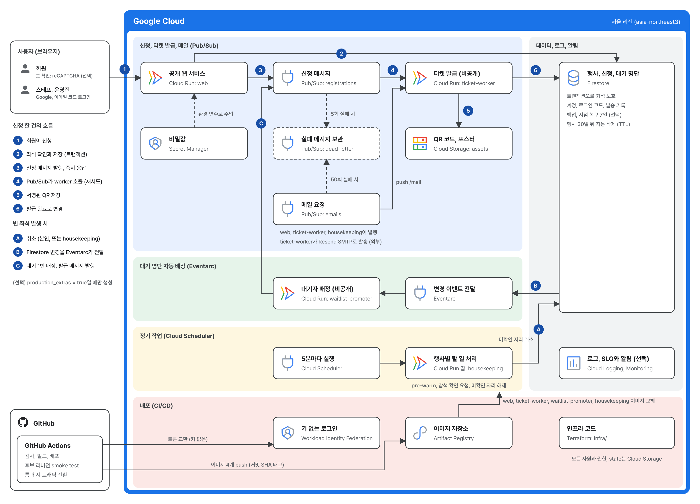

# Cloud Ticketing 실습

앱 코드는 이미 완성되어 있습니다. 이번 실습에서는 앱을 짜지 않습니다. 명령 하나로 자신의 Google Cloud 프로젝트에 올린 뒤, 빠진 연결을 직접 잇고, 클라우드 쪽에서 일어나는 일을 콘솔에서 확인합니다.

**이 실습의 목적:** 신청이 몰리는 티켓팅 서비스에서 Cloud Run이 요청을 어떻게 처리하고, 오래 걸리는 작업을 어떻게 분리하며, 장애와 배포, 트래픽 증가에 서비스가 어떻게 대응하는지 직접 확인합니다.

| 핵심 개념 | 단계 |
|---|---|
| 비동기 처리 (Pub/Sub push 구독) | 4 |
| 재시도, 멱등성, dead letter | 5, 6 |
| 이벤트 기반 처리 (Eventarc) | 7 |
| 예약 작업 (Cloud Scheduler, Cloud Run 잡) | 8 |
| 접근 제어 (인그레스, 서비스 계정, Secret Manager, 키 없는 배포) | 9 |
| 데이터 저장 (Firestore 트랜잭션과 TTL, Cloud Storage) | 10 |
| 로그와 측정항목 | 11 |
| 컨테이너 이미지와 CI/CD | 12 |
| 리비전, 트래픽, 롤백, 시작 프로브 | 13, 14 |
| 콜드 스타트, 자동 확장, 동시성, 사전 준비 | 15~18 |
| 비용 | 0, 19 |

**1부**는 0~11단계, **2부**는 12~19단계입니다. 시작하기 전에 [사전 학습](lab-preread.ko.md)의 확인 질문에 답할 수 있는지 먼저 봐 주세요.

**진행 방법:** 각 단계의 "예상"을 먼저 읽고, 어떤 결과가 나올지 스스로 답한 뒤 실행합니다. 대부분의 작업은 콘솔에서 할 수 있고, 같은 작업을 명령으로 하는 방법은 접어 두었습니다. 화면을 보지 않고 넘어가면 마지막 퀴즈를 풀 수 없습니다.

## 시작 전에

| 준비물 | 확인할 것 |
|---|---|
| Google Cloud 무료 체험 계정 | [결제](https://console.cloud.google.com/billing) 화면에서 남은 기간과 크레딧 확인. 9월 22일에 가입했다면 12월 21일쯤 끝납니다 |
| 개인 GitHub 계정 | 저장소는 비공개로, 회사나 동아리 조직이 아닌 개인 계정에 만들어집니다 |
| 실습 저장소 주소 | 스터디 공지에 있습니다 |

**비용.** 무료 체험 크레딧으로 처리되며, 직접 업그레이드하지 않으면 청구되지 않습니다. **"전체 계정으로 업그레이드" 버튼은 누르지 마세요.** 카드가 없거나 체험 기간이 끝났다면 스터디장에게 알려 주세요. 별도 프로젝트를 만들어 드립니다.

콘솔에서는 왼쪽 위 메뉴나 상단 검색창으로 화면을 이동합니다. 모든 화면에서 **위쪽의 프로젝트 선택 메뉴에 실습 프로젝트가 선택되어 있는지** 먼저 확인합니다. 콘솔에서 **작업**이라고 표시되는 것이 이 문서의 **잡**입니다.



# 1부. 설치와 백그라운드 처리

## 0단계. 프로젝트와 예산

1. [새 프로젝트](https://console.cloud.google.com/projectcreate)를 만들고, 이름 아래의 **프로젝트 ID**를 적어 둡니다.
2. **결제 → 예산 및 알림**에서 새 예산을 만듭니다. 범위는 실습 프로젝트, 금액은 12,000원입니다.
3. 상단의 터미널 아이콘으로 Cloud Shell을 열고 실습 저장소를 받습니다.

```bash
git clone 저장소_주소 gdgoc-tickets && cd gdgoc-tickets
```

Cloud Shell은 오래 쉬면 연결이 끊깁니다. 다시 접속하면 `cd ~/gdgoc-tickets`부터 실행합니다.

**이유:** 예산은 지출을 알려 줄 뿐, 그 자체로 서비스를 멈추지는 않습니다. 실습이 끝나면 19단계에서 실제 비용과 비교합니다.

## 1단계. 설치와 배포

```bash
./lab up 프로젝트_ID
```

GitHub 로그인이 나오면 Enter를 누르고, [github.com/login/device](https://github.com/login/device)에서 화면의 코드를 입력합니다. 끝날 때까지 10~15분 정도 걸립니다. `Google Cloud is not ready yet`이 나와도 자동으로 다시 시도합니다.

- **확인:** 마지막에 `Ready.`와 사이트 주소가 나옵니다.

```bash
source ~/.bashrc
./lab check
```

맨 아래의 `NOT` 한 줄(Pub/Sub 연결)은 지금은 이렇게 나오는 것이 정상입니다. 4단계에서 해결합니다.

| 메시지 | 해결 |
|---|---|
| `cannot see project` | 프로젝트 ID 오타 확인 (프로젝트 이름과 다릅니다) |
| `no billing account linked` | [결제](https://console.cloud.google.com/billing/projects)에서 프로젝트에 결제 계정 연결 |
| `The deploy failed` | `gh workflow run ci.yml --ref main`으로 다시 배포 |

## 2단계. 만들어진 것 둘러보기

**예상:** 인터넷에 공개되는 서비스는 어느 것이고, `ticket-worker`는 누가 호출할까요?

콘솔에서 [Cloud Run](https://console.cloud.google.com/run)을 엽니다.

1. **서비스** 목록에서 `web`, `ticket-worker`, `waitlist-promoter`를, **작업** 목록에서 `housekeeping`을 찾습니다.
2. `web`을 열고 **네트워킹** 탭의 **인그레스**(어디서 오는 요청을 받을지 정하는 설정)를 봅니다. 같은 탭을 `ticket-worker`에서도 봅니다. `web`은 **전체**, `ticket-worker`는 **내부**입니다.
3. `ticket-worker`의 **확장** 탭에서 **인스턴스의 최대 개수**와 **인스턴스당 최대 동시 요청 수**를 적어 둡니다. `web`과 비교합니다.

## 3단계. 로그인과 첫 행사

1. 출력된 주소의 `/login`에서 **Google Cloud에 로그인한 이메일**을 입력하고 코드를 요청합니다.
2. 메일은 꺼져 있으므로 코드는 로그에서 확인합니다.

```bash
./lab code
```

   출력이 비어 있으면 30초 뒤 다시 실행합니다. 마지막의 6자리 코드를 로그인 화면에 입력합니다.

3. `/admin`에서 **새 행사 만들기**를 누르고 입력합니다. 시각은 모두 한국 시간입니다.

| 항목 | 값 |
|---|---|
| 행사 이름, 장소 | 자유롭게 입력 |
| 주소 | `wiring` |
| 신청 시작 | 지금보다 2시간 전 |
| 신청 마감 | 내일 |
| 시작, 종료 | 모레 (시작이 종료보다 먼저) |
| 참석 확인 마감 | 내일과 모레 사이 |
| 정원, 대기 정원 | 200, 50 |
| 공개 | 체크 |

이후 행사도 달라지는 값만 적겠습니다. 나머지는 이 표와 같고, **공개 체크를 잊지 않습니다.** 공개하지 않으면 신청 페이지가 열리지 않습니다.

## 4단계. 빠진 연결 잇기 (비동기 처리)

`/events/wiring`에서 신청합니다. 로그인한 이메일로 신청됩니다.

- **예상:** 신청 완료 화면은 바로 나오지만, 티켓은 "**티켓 발급 중**"에서 멈춥니다.

왜 멈췄는지 콘솔에서 찾습니다.

1. [Pub/Sub 구독](https://console.cloud.google.com/cloudpubsub/subscription/list)에서 `ticket-worker`를 열고 **수정**을 누릅니다. **전송 유형**이 **가져오기**입니다. `mailer` 구독과 비교합니다.
2. 이 화면을 **스크린샷 1**로 남깁니다.

신청 요청은 `web`에서 끝납니다. 티켓을 만드는 일은 Pub/Sub 메시지로 넘기는데, `ticket-worker` 구독은 메시지를 어디로 보낼지 모릅니다. 메시지는 사라지지 않고 구독에 쌓여 있습니다.

**연결합니다.**

1. Cloud Run의 `ticket-worker` 화면 위쪽에 있는 **URL**을 복사합니다.
2. 구독 수정 화면에서 **전송 유형**을 **푸시**로 바꾸고, **엔드포인트 URL**에 붙여 넣습니다.
3. **인증 사용 설정**을 켜고, **서비스 계정**에서 `tickets-pubsub-push`를 고릅니다. **대상**은 비워 둡니다.
4. **업데이트**를 누릅니다.

<details>
<summary>명령으로 하기</summary>

```bash
URL=$(gcloud run services describe ticket-worker --region asia-northeast3 --format='value(status.url)')
gcloud pubsub subscriptions update ticket-worker --push-endpoint="$URL" \
  --push-auth-service-account="tickets-pubsub-push@$(gcloud config get-value project).iam.gserviceaccount.com"
```
</details>

- **확인:** 새로 신청하지 않고 기다립니다. 조금 전의 티켓이 잠시 후 발급됩니다.
- **왜 이렇게 될까요?** `web`은 메시지를 넣고 바로 응답했고, 메시지는 구독에서 기다리고 있었습니다. 연결되는 순간 전달되어 처리됩니다.

> **스크린샷 1:** 구독의 전송 유형(연결 전과 후), 발급된 티켓

**더 알아보기:** 구독 수정 화면의 **메시지 보관 기간**은 얼마인가요? 이 기간이 지나면 메시지는 어떻게 되나요?

## 5단계. 같은 메시지를 다시 보내기 (멱등성)

Pub/Sub는 같은 메시지를 두 번 이상 전달할 수 있습니다. 일부러 같은 메시지를 보내 봅니다. 티켓 ID는 티켓 주소 `/t/티켓_ID`의 마지막 부분입니다.

**예상:** 티켓이 하나 더 생길까요?

[Pub/Sub 주제](https://console.cloud.google.com/cloudpubsub/topic/list)에서 `registrations`를 열고 **메시지** 탭의 **메시지 게시**를 누릅니다. 메시지 본문에 다음을 넣고 게시합니다.

```json
{"registration_id":"티켓_ID"}
```

30초쯤 뒤, Cloud Run의 `ticket-worker`에서 **모니터링 가능성 → 로그**를 엽니다.

- **확인:** `skip 티켓_ID (status issued)`가 보입니다. 티켓은 그대로 하나입니다.
- **이유:** 전달이 "최소 한 번"이면 받는 쪽이 중복을 안전하게 처리해야 합니다. 같은 작업을 여러 번 해도 결과가 같은 성질이 멱등성입니다.

<details>
<summary>명령으로 하기</summary>

```bash
gcloud pubsub topics publish registrations --message '{"registration_id":"티켓_ID"}'
gcloud logging read 'resource.labels.service_name="ticket-worker" AND "티켓_ID"' --limit 5 --format 'value(timestamp, jsonPayload.message)'
```
</details>

> **스크린샷 2:** `skip` 로그

## 6단계. 워커 장애, 재시도, dead letter

`ticket-worker`가 모든 요청에 실패하도록 설정을 바꿉니다.

1. Cloud Run의 `ticket-worker`에서 **컨테이너** 탭을 엽니다.
2. **변수 및 보안 비밀**의 **환경 변수**에서 **변수 추가**를 누르고 `WORKER_FAIL_RATE` = `1`을 넣습니다.
3. 위쪽의 **다시 배포**를 누르고 **새 버전 배포**를 누릅니다.
4. **업데이트 기록** 탭에서 새 리비전이 트래픽 100%인지 확인합니다. 배포가 끝나기 전에 신청하면 티켓이 정상 발급됩니다.

브라우저의 **시크릿 창**에서 `/events/wiring`을 열고 **다른 이메일로** 신청합니다. 로그인한 창에서는 이메일을 바꿀 수 없습니다.

**예상:** 신청은 성공할까요? 티켓은 어떻게 될까요?

`ticket-worker`의 **모니터링 가능성 → 로그**에서 500 응답을 봅니다. 일정한 간격을 두고 반복됩니다. Pub/Sub가 재시도하고 있다는 뜻입니다. 구독의 **데드 레터 처리** 탭에서 설정을 확인합니다. 최대 전송 시도 횟수는 5회입니다.

**3분쯤 기다린 뒤** 터미널에서 실패한 메시지를 확인합니다.

```bash
scripts/replay-dead-letters.sh
```

- **확인:** `1 messages waiting`이 나옵니다. 재시도 횟수를 모두 채운 메시지가 dead-letter 주제로 옮겨진 것입니다. 0이면 1분 뒤 다시 실행합니다. 2 이상이면 5분마다 도는 잡이 밀린 티켓을 한 번 더 발행한 것이므로 정상입니다.

이제 고칩니다. 같은 **환경 변수** 화면에서 `WORKER_FAIL_RATE`를 지우고 **다시 배포**합니다. 새 리비전이 100%가 된 것을 확인한 뒤 메시지를 다시 보냅니다.

```bash
scripts/replay-dead-letters.sh --replay
```

- **확인:** 티켓이 몇 초 안에 발급됩니다.

<details>
<summary>환경 변수를 명령으로 바꾸기</summary>

```bash
gcloud run services update ticket-worker --region asia-northeast3 --update-env-vars WORKER_FAIL_RATE=1
gcloud run services update ticket-worker --region asia-northeast3 --remove-env-vars WORKER_FAIL_RATE
```
</details>

> **스크린샷 3:** 500이 반복되는 로그, `1 messages waiting` 출력

**더 알아보기:** 메시지를 다시 보내지 않아도 5분마다 도는 잡이 밀린 티켓을 다시 발행합니다. `jobs/housekeeping.py`의 `repair`를 읽어 보세요. 왜 5분을 기다릴까요?

## 7단계. 빈 자리 자동 배정 (Eventarc)

**새 행사** `promo`를 만듭니다. 정원 1, 대기 정원 1, 신청 시작은 2시간 전입니다.

1. 로그인한 창에서 `/events/promo`에 신청해 자리를 받습니다.
2. 시크릿 창에서 다른 이메일로 신청합니다. **대기 1번**이 됩니다.
3. [Eventarc 트리거](https://console.cloud.google.com/eventarc/triggers)에서 `registration-changed`의 **이벤트 제공자**, **이벤트 유형**, **대상**을 읽습니다.

**예상:** 첫 번째 신청을 취소하면 누가, 무엇을 보고 대기자에게 자리를 줄까요?

4. 첫 번째 티켓 화면에서 신청을 취소합니다.
5. 시크릿 창의 티켓 화면을 봅니다.

- **확인:** 몇 초 안에 대기자가 티켓을 받습니다. Cloud Run의 `waitlist-promoter`에서 **모니터링 가능성 → 로그**를 봅니다.
- **왜 이렇게 될까요?** 취소로 Firestore 문서가 바뀌면 Eventarc가 그 변경을 `waitlist-promoter`로 전달합니다. `web`은 대기자 처리에 관여하지 않고, 취소가 어디서 일어나든 같은 과정을 거칩니다.

[Firestore Studio](https://console.cloud.google.com/firestore/databases/-default-/data)의 `registrations` 컬렉션에서 두 문서의 `status`를 확인합니다.

> **스크린샷 4:** 트리거 화면, 대기자에게 발급된 티켓

## 8단계. 예약 작업 (Cloud Scheduler, Cloud Run 잡)

요청에 응답하는 서비스와 달리, 잡은 할 일을 마치면 종료됩니다.

1. [Cloud Scheduler](https://console.cloud.google.com/cloudscheduler)에서 `housekeeping`의 **빈도**와 **대상**을 읽습니다.
2. 행의 메뉴에서 **강제 실행**을 누릅니다.
3. Cloud Run의 **작업 → housekeeping → 기록**에서 새 실행이 생기는 것을 봅니다. 실행을 열어 로그를 읽습니다.

<details>
<summary>명령으로 하기</summary>

```bash
gcloud scheduler jobs run housekeeping --location asia-northeast3
gcloud run jobs executions list --job housekeeping --region asia-northeast3 --limit 3
```
</details>

> **스크린샷 5:** 잡의 실행 기록

## 9단계. 접근 제어

**예상:** `ticket-worker`의 주소를 알면 인터넷에서 호출할 수 있을까요?

```bash
curl -s -o /dev/null -w '%{http_code}\n' "$(gcloud run services describe ticket-worker --region asia-northeast3 --format='value(status.url)')/"
```

- **확인:** `404`가 나옵니다. **네트워킹** 탭의 **인그레스**가 **내부**이기 때문입니다. Pub/Sub는 Google 내부 경로로 호출할 수 있습니다.

콘솔에서 차례로 봅니다.

| 볼 곳 | 확인할 것 |
|---|---|
| Cloud Run → 각 서비스 → **보안** 탭 → **서비스 계정** | 서비스마다 계정이 다릅니다 |
| IAM 및 관리자 → **서비스 계정** | `tickets-`로 시작하는 계정 목록과 설명 |
| 보안 → [보안 비밀 관리자](https://console.cloud.google.com/security/secret-manager) | `ticket-secret`, `session-secret`의 존재. 값은 코드에 없습니다 |
| Cloud Run → `web` → **컨테이너** 탭 → **환경 변수로 노출된 보안 비밀** | 비밀값이 앱에 전달되는 방법 |
| IAM 및 관리자 → [워크로드 아이덴티티 제휴](https://console.cloud.google.com/iam-admin/workload-identity-pools) → `github` | GitHub Actions가 키 파일 없이 로그인하는 설정. **제공업체**의 조건에서 자신의 GitHub 저장소 번호(숫자 ID)와 `main`을 찾습니다 |

**이유:** 서비스마다 필요한 권한만 주면, 하나가 침해되어도 나머지는 지킬 수 있습니다.

> **스크린샷 6:** `404` 출력, `ticket-worker`의 인그레스 설정

## 10단계. 데이터 저장

**Firestore.** [Firestore Studio](https://console.cloud.google.com/firestore/databases/-default-/data)를 엽니다.

1. `event_counts` 컬렉션에서 `wiring` 문서의 숫자를 적습니다.
2. 시크릿 창을 모두 닫고 새로 연 뒤, 6단계와 다른 이메일로 신청하고 숫자가 바뀌는 것을 봅니다.
3. 왼쪽 메뉴의 **TTL**(정해진 시각이 지나면 문서를 자동으로 지우는 기능)에서 `expire_at`을 기준으로 지우는 컬렉션을 봅니다.

**Cloud Storage.** [버킷](https://console.cloud.google.com/storage/browser)에서 `프로젝트_ID-assets`를 엽니다.

1. `tickets/` 폴더에서 QR 파일을 찾습니다. 맨 위의 **공개 액세스**는 **공개 아님**입니다.
2. **수명 주기** 탭의 규칙을 읽습니다.

**예상:** 이 파일의 주소를 알면 누구나 볼 수 있을까요?

```bash
curl -s -o /dev/null -w '%{http_code}\n' "https://storage.googleapis.com/프로젝트_ID-assets/tickets/파일이름"
```

- **확인:** `403`이 나옵니다. QR은 `web`을 거쳐야 볼 수 있습니다.

> **스크린샷 7:** `event_counts` 문서, 버킷의 공개 액세스

## 11단계. 로그와 측정항목

티켓 화면의 **코드**(예: `CEJ-N45`) 하나를 고릅니다. [로그 탐색기](https://console.cloud.google.com/logs/query)의 쿼리 창에 큰따옴표와 함께 넣고 **쿼리 실행**을 누릅니다.

```
"티켓_코드"
```

- **확인:** `web`의 `signup` 로그와 `ticket-worker`의 `issued ticket` 로그가 나옵니다. 요청 하나가 여러 서비스를 지나간 경로입니다.

Cloud Run의 `web`에서 **모니터링 가능성 → 측정항목**을 열고 **요청 수**와 **요청 지연 시간**을 봅니다.

> **스크린샷 8:** 로그 탐색기 결과

# 2부. 배포, 확장, 비용

## 12단계. 컨테이너 이미지와 CI

1. [Artifact Registry](https://console.cloud.google.com/artifacts)에서 `gdgoc-tickets`를 엽니다. 이미지가 4개이고, 태그는 커밋 SHA입니다. `Dockerfile`을 열어 파일 하나에서 이미지 4개가 어떻게 만들어지는지 봅니다.
2. GitHub 저장소의 **Actions**에서 최근 실행을 엽니다. 검사, 빌드, 배포 순서를 확인합니다.

테스트를 일부러 깨뜨립니다.

```bash
echo -e '\n\ndef test_broken():\n    assert 1 == 2' >> tests/test_service.py
git add tests && git commit -m "Break a test" && git push
```

**예상:** 이 코드는 배포될까요?

- **확인:** Actions에서 `test`가 실패하고 `deploy`는 실행되지 않습니다. Cloud Run의 리비전도 그대로입니다.

되돌립니다.

```bash
git revert --no-edit HEAD && git push
```

Actions에서 이 실행이 끝난 뒤 다음 단계로 넘어갑니다.

> **스크린샷 9:** 실패한 Actions 실행

## 13단계. 리비전, 새 리비전 사전 검사, 롤백

Cloud Run의 `web`에서 **업데이트 기록** 탭을 엽니다. 리비전마다 트래픽 비율이 보입니다.

테스트는 통과하지만 Cloud Run에서만 실패하는 코드를 올립니다. `cloudshell edit web/events.py`로 파일을 열고, `home` 함수 맨 위에 다음 두 줄을 넣습니다.

```python
    if get_settings().on_cloud_run:  # only on Cloud Run, so the tests still pass
        raise RuntimeError("deliberate failure")
```

```bash
git add web && git commit -m "Break on Cloud Run" && git push
```

**예상:** 사이트가 멈출까요?

- **확인:** Actions의 `deploy`에서 **Smoke test web's new revision**이 실패하고 **Put everything back**이 실행됩니다. 새 리비전은 트래픽 0%로 올라가고, 자신만의 URL로 먼저 호출되어 검사받습니다. 사이트는 계속 정상이고, **업데이트 기록**에는 트래픽 0%의 새 리비전이 남습니다. `lint`나 `test`가 실패했다면 붙여 넣은 코드의 들여쓰기를 확인합니다.

되돌리고 다시 배포합니다.

```bash
git revert --no-edit HEAD && git push
```

배포가 끝나면 콘솔에서 직접 롤백합니다. **업데이트 기록**의 맨 위는 방금 배포한 리비전이고, 바로 아래는 일부러 깨뜨린 리비전입니다. **그 아래의 정상 리비전**으로 되돌립니다.

1. **업데이트 기록**에서 **트래픽 관리**를 누릅니다.
2. 그 정상 리비전을 100%로, 나머지를 0%로 두고(합계 100%) 저장합니다.
3. `curl -sI 사이트_주소/health | grep -i x-served-by`로 응답한 리비전을 확인합니다. 사이트 주소는 `./lab check`에 나옵니다. 몇 초 안에 바뀝니다. 브라우저에서 첫 화면도 열어 정상인지 확인합니다.
4. 같은 화면에서 최신 리비전을 다시 100%로 돌립니다.

<details>
<summary>명령으로 하기</summary>

```bash
gcloud run services update-traffic web --region asia-northeast3 --to-revisions 이전_리비전=100
gcloud run services update-traffic web --region asia-northeast3 --to-latest
```
</details>

**왜 빠를까요?** 빌드 없이, 이미 있는 리비전으로 요청의 방향만 바꾸기 때문입니다.

> **스크린샷 10:** Put everything back이 실행된 Actions, 트래픽 관리 화면

## 14단계. 시작에 실패하는 버전

`web`의 **컨테이너** 탭에서 **상태 확인**의 **시작 프로브**를 읽습니다. 앱이 `/health`에 응답해야 트래픽을 받습니다. 일부러 시작에 실패하는 리비전을 만들어 봅니다. `/bin/false`는 바로 실패로 끝나는 명령이고, `--no-traffic`은 새 리비전에 트래픽을 주지 않는 옵션이며, `--tag`는 리비전에 전용 주소를 붙입니다.

```bash
gcloud run services update web --region asia-northeast3 --command=/bin/false --no-traffic --tag broken
```

**예상:** 이 리비전은 준비 완료 상태가 될까요?

- **확인:** 명령이 실패합니다. **업데이트 기록**에 실패 표시가 있는 리비전이 생깁니다. 앱이 `/health`에 응답하지 못해 시작 프로브를 통과하지 못했기 때문입니다.

**이 단계의 설정은 반드시 되돌립니다.** 되돌리지 않으면 이후의 리비전도 같은 명령으로 만들어집니다.

```bash
gcloud run services update web --region asia-northeast3 --command=""
gcloud run services update-traffic web --region asia-northeast3 --to-latest --remove-tags broken
```

> **스크린샷 11:** 실패한 리비전이 보이는 업데이트 기록

## 15단계. 콜드 스타트

다음 단계들에 쓸 값을 콘솔에서 바꿉니다. 바꾼 뒤에는 각각 위쪽의 **다시 배포 → 새 버전 배포**를 누릅니다.

| 위치 | 환경 변수 | 값 | 이유 |
|---|---|---|---|
| `web` → 컨테이너 탭 | `SIGNUPS_PER_MINUTE_PER_IP` | `5000` | 부하 테스트의 요청이 모두 Cloud Shell 주소 하나에서 나감 |
| `ticket-worker` → 컨테이너 탭 | `WORKER_DELAY_MS` | `2000` | 티켓마다 2초 지연을 넣어 대기열이 쌓이게 함 |

잡은 **작업 → housekeeping → 작업 구성 보기 및 수정**을 엽니다. **컨테이너** 탭의 **변수 및 보안 비밀**에서 `PREWARM_INSTANCES`를 `0`으로 바꾸고 **완료**, 맨 아래 **업데이트**를 누릅니다. 그런 다음 **실행**을 눌러 바로 반영합니다. 자동 확장을 보려면 사전 준비가 꺼져 있어야 합니다.

`web`의 **YAML** 탭을 새로고침해 `run.googleapis.com/minScale`이 없거나 `0`인지 확인합니다.

<details>
<summary>명령으로 하기</summary>

```bash
gcloud run services update web --region asia-northeast3 --update-env-vars SIGNUPS_PER_MINUTE_PER_IP=5000
gcloud run services update ticket-worker --region asia-northeast3 --update-env-vars WORKER_DELAY_MS=2000
gcloud run jobs update housekeeping --region asia-northeast3 --update-env-vars PREWARM_INSTANCES=0
gcloud run jobs execute housekeeping --region asia-northeast3 --wait
```
</details>

**사이트를 열어 둔 브라우저 탭을 모두 닫고 16분 이상 기다립니다.** 탭이 열려 있으면 요청이 계속 들어갑니다. 기다린 뒤 측정합니다.

```bash
URL=$(gcloud run services describe web --region asia-northeast3 --format='value(status.url)')
scripts/latency.sh "$URL/health" 5
```

- **예상:** 첫 요청은 몇 초, 이후 요청은 0.1초 안쪽입니다.
- **왜 이렇게 될까요?** 첫 요청은 컨테이너를 시작하고 Python 모듈을 불러오는 시간을 기다립니다. **컨테이너** 탭의 **시작 CPU 부스트**가 이 시간을 줄입니다.

측정값을 적어 둡니다.

## 16단계. 신청이 몰릴 때 (자동 확장)

바로 이어서 `/admin`에서 새 행사를 만듭니다. 주소 `rush-a`, 신청 시작 **지금부터 3분 뒤**, 정원 100, 대기 정원 50입니다. 신청 시작 시각이 되면 실행합니다.

[Locust](https://locust.io)는 가상 방문자를 만들어 요청을 보내는 부하 테스트 도구입니다.

```bash
URL=$(gcloud run services describe web --region asia-northeast3 --format='value(status.url)')
locust -f loadtest/locustfile.py --headless --host "$URL" --event-id rush-a --users 300 --spawn-rate 10 --run-time 6m
```

- **예상:** `web`의 동시성은 40, 최대 인스턴스는 20개입니다. 인스턴스는 몇 개까지 늘어날까요? 100석을 넘겨 발급될까요?
- **확인:** `Signups:` 줄과 "Response time percentiles" 표의 POST 행(50%가 중앙값, 95%)을 적어 둡니다. 인스턴스 최대 수는 그래프의 가장 높은 값입니다. **3~5분 뒤** 그래프를 봅니다. 측정값은 늦게 표시됩니다.
  - Cloud Run → `web` → **모니터링 가능성 → 측정항목:** **컨테이너 인스턴스 수**
  - Pub/Sub → 구독 → `ticket-worker` → **측정항목:** 미확인 메시지 수(아직 처리되지 않은 메시지)
- **왜 이렇게 될까요?** Cloud Run은 인스턴스당 동시 요청 수와 CPU 사용률을 보고 인스턴스를 늘립니다. 방문자 300명이 곧 동시 요청 300개는 아닙니다. 요청 하나가 짧고 방문자마다 몇 초에 한 번씩 보내기 때문입니다. 새 인스턴스가 뜨는 동안 먼저 온 신청은 기다립니다.

> **스크린샷 12:** 인스턴스 수 그래프, 대기열 그래프, Locust 결과

## 17단계. 동시성을 바꾸면

**예상:** 인스턴스 하나가 동시에 처리하는 요청을 2개로 줄이면, 방문자가 절반이어도 인스턴스 수는 어떻게 될까요?

1. `web`의 **확장** 탭에서 **인스턴스당 최대 동시 요청 수**를 `2`로 바꾸고 **다시 배포 → 새 버전 배포**를 누른 뒤, 새 리비전이 100%인지 확인합니다.
2. `rush-c` 행사를 만듭니다. 신청 시작 **1분 뒤**, 정원 100, 대기 정원 50입니다.
3. 부하를 넣습니다.

```bash
URL=$(gcloud run services describe web --region asia-northeast3 --format='value(status.url)')
locust -f loadtest/locustfile.py --headless --host "$URL" --event-id rush-c --users 150 --spawn-rate 10 --run-time 3m
```

3~5분 뒤 **컨테이너 인스턴스 수**를 16단계와 비교합니다. 그런 다음 같은 탭에서 `40`으로 되돌리고 **다시 배포 → 새 버전 배포**를 누른 뒤, 새 리비전이 100%인지 확인합니다.

> **스크린샷 13:** 동시성 2에서의 인스턴스 수 그래프

## 18단계. 사전 준비

신청이 몰리는 시각을 미리 안다면 인스턴스를 먼저 띄워 둘 수 있습니다.

1. 15단계의 잡 화면에서 `PREWARM_INSTANCES`를 `3`으로 바꾸고 **완료**, **업데이트**를 누릅니다.
2. `rush-b` 행사를 만듭니다. 신청 시작 **지금부터 10분 뒤**, 정원 100, 대기 정원 50입니다.
3. 잡을 **실행**합니다.
4. 실행이 끝나면 `web`의 **YAML** 탭을 새로고침해 `run.googleapis.com/minScale: '3'`을 찾습니다.

**예상:** 16단계와 비교해 인스턴스 수와 응답 시간은 어떻게 달라질까요?

신청 시작 시각이 되면 16단계의 명령 두 줄을 `--event-id rush-b`로 실행합니다.

- **이유:** 사전 준비를 쓰면 인스턴스를 기다리는 시간은 없어지지만, 요청이 없는 동안에도 비용이 듭니다.

> **스크린샷 14:** 16단계와 비교할 수 있는 그래프, Locust 결과

## 19단계. 비용과 정리

**예상:** 아무도 접속하지 않아도 비용이 드는 것은 무엇일까요?

먼저 `./lab check`를 실행해 출력을 복사해 둡니다. 제출에 필요합니다. `web`의 **모니터링 가능성 → 측정항목**에서 **청구 가능한 컨테이너 인스턴스 시간**을 봅니다.

```bash
./lab check
./lab down
```

프로젝트 ID를 입력하면 삭제가 시작됩니다.

- **확인:** 사이트에 접속되지 않습니다. 목록에 `프로젝트_ID-tfstate` 버킷이 남는 것은 정상입니다. 다시 실습하지 않는다면 지웁니다.
- 실습을 완전히 끝냈다면 [리소스 관리](https://console.cloud.google.com/cloud-resource-manager)에서 프로젝트를 삭제합니다. 다음 날 **결제 → 보고서**에서 가장 큰 항목을 확인하고, 0단계의 예산과 비교합니다.

> **스크린샷 15:** `./lab down`의 마지막 출력, 결제 보고서

## 제출

공지된 설문에 다음을 제출합니다.

1. 19단계에서 복사해 둔 `./lab check` 출력
2. 스크린샷 1~15
3. 측정표

| | 16단계 (사전 준비 끔) | 18단계 (사전 준비 켬) |
|---|---|---|
| web 인스턴스 최대 수 | | |
| 신청 응답 중앙값 | | |
| 신청 응답 95% | | |
| 좌석, 대기 | | |

4. 아래 퀴즈의 답
5. 한 문장: **이 실습은 무엇을 다뤘나요?**

## 퀴즈

각 문항은 2점입니다. 결과만 맞으면 1점, **자신의 측정값이나 화면을 근거로 이유까지 설명하면** 2점입니다.

1. 4단계에서 신청 응답은 바로 왔는데 티켓은 왜 나오지 않았나요? 그동안 메시지는 어디에 있었나요?
2. 5단계에서 같은 메시지를 보냈는데 티켓이 늘지 않았습니다. `ticket_worker/main.py`의 `issue`에서 어떤 확인이 이것을 막았나요?
3. 6단계에서 워커가 실패하는 동안 신청자가 겪은 일과 겪지 않은 일을 쓰세요. 재시도 횟수를 모두 채운 메시지는 어디로 갔나요?
4. 7단계에서 대기자에게 자리를 준 것은 누구이고, 무엇을 보고 시작했나요? `web`이 직접 처리하지 않아서 얻는 점은 무엇인가요?
5. `housekeeping`은 왜 서비스가 아니라 잡인가요?
6. 9단계의 `404`와 10단계의 `403`은 각각 어떤 설정 때문인가요?
7. 300명이 몰렸는데 좌석 수를 넘겨 발급되지 않았습니다. 무엇이 이를 보장하나요? `shared/gcp.py`의 `register`를 읽고 답하세요.
8. 13단계에서 깨진 버전이 사용자에게 닿지 않은 이유는 무엇인가요? 롤백이 몇 초 만에 끝나는 이유는요?
9. 15단계에서 잰 첫 요청과 이후 요청의 시간을 쓰세요. 차이는 무엇을 기다린 시간인가요?
10. 16, 17, 18단계의 인스턴스 수를 비교하고, 달라진 이유를 쓰세요. 사전 준비가 필요 없는 상황을 한 가지 쓰세요.

## 더보기

클라우드 개념과 직접 관련이 없는 앱 내부 구현입니다.

<details>
<summary>화면과 백엔드</summary>

화면은 `web/templates`와 `web/static`, API는 `web/`의 FastAPI 라우터에 있습니다.
</details>

<details>
<summary>QR 서명과 입구 체크인</summary>

QR에는 위조를 막기 위한 서명이 들어 있습니다. `shared/tokens.py`와 `/checkin` 화면에서 볼 수 있습니다.
</details>

<details>
<summary>로그인과 메일</summary>

이메일 코드와 Google 로그인은 `web/auth.py`에 있습니다. 메일 발송은 Resend를 쓰며 `shared/mail.py`에 있습니다. 실습에서는 꺼 두고 코드를 로그에서 읽습니다.
</details>

<details>
<summary>노트북에서 실행하기</summary>

같은 코드가 SQLite와 직접 HTTP 호출로 노트북에서도 동작합니다. [README](../README.md)의 "실행"을 참고하세요.
</details>

<details>
<summary>모니터링, 알림, 봇 방지</summary>

`production_extras = true`로 켜면 업타임 체크, 알림, SLO, reCAPTCHA, 백업이 추가됩니다. 모니터링은 뒤 회차에서 다룹니다. Google Cloud 자원은 Terraform으로 만들어지며, Terraform도 별도 회차에서 다룹니다.
</details>
